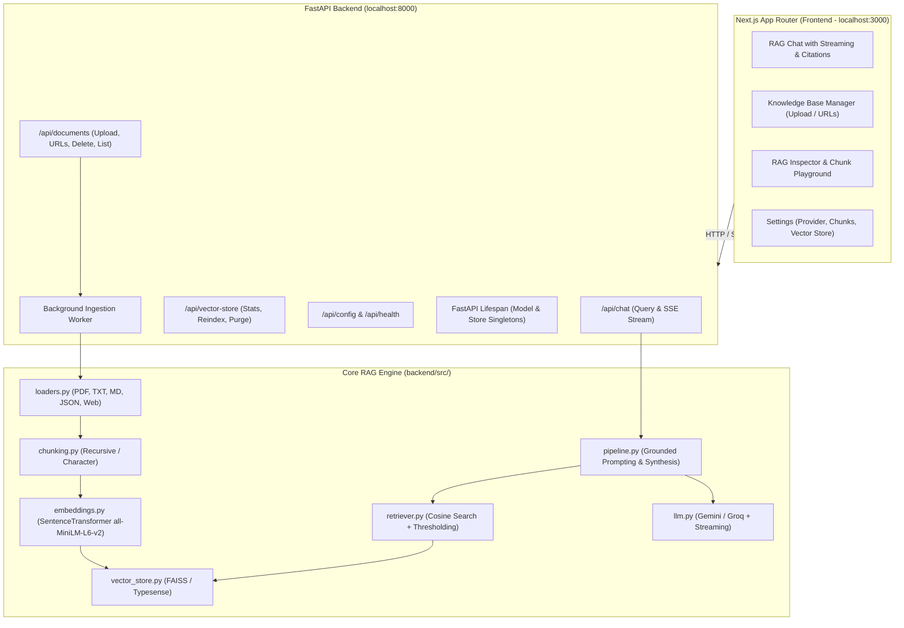

# RAG SaaS Platform

A Retrieval-Augmented Generation (RAG) application with a Next.js interface and a FastAPI/Python backend. It supports document and URL ingestion, semantic search, grounded answers with citations, streaming responses, and FAISS or Typesense vector storage.

## Project layout

```text
.
|- backend/                         # Python/FastAPI application
|  |- api/                          # FastAPI routes, schemas, and services
|  |- src/                          # RAG engine: loaders, chunking, embeddings, retrieval, LLMs
|  |- data/                         # Seed documents and persisted local vector data
|  |- tests/                        # Python API and RAG-engine tests
|  |- .env.example                  # Backend environment template
|  |- main.py                       # Standalone RAG pipeline example
|  |- pyproject.toml                # Python/uv project definition
|  `- requirements.txt              # Python dependency list
|- frontend/                        # Next.js application
|  |- app/                          # UI and Next.js API routes
|  |- components/                   # Chat, knowledge-base, playground, and settings views
|  |- lib/                          # Client-side RAG store and utilities
|  `- tests/                        # TypeScript integration and workflow tests
|- package.json                     # Root workspace commands
`- development-phases.md            # Development history and roadmap
```

## System architecture



## Quick start

Configure backend credentials first:

```bash
Copy-Item backend/.env.example backend/.env
```

Set the relevant API keys in `backend/.env`, then start the backend:

```bash
cd backend
uv sync
uv run uvicorn api.main:app --host 127.0.0.1 --port 8000 --reload
```

In a second terminal at the repository root, start the frontend:

```bash
npm install
npm run dev
```

Open [http://localhost:3000](http://localhost:3000). FastAPI documentation is at [http://127.0.0.1:8000/docs](http://127.0.0.1:8000/docs).

## Application workflow

1. Start the backend and frontend, then open the app in the browser.
2. In **Knowledge Base**, upload a PDF, text, Markdown, JSON/JSONL file, or provide one or more public URLs. The backend loads, chunks, embeds, and indexes the content.
3. In **Chat**, select or create a conversation and ask a question. The app retrieves relevant chunks, produces a grounded answer, and shows source citations; streaming is available through SSE.
4. Use **Playground** to inspect raw semantic-search results or test chunking settings without generating an LLM answer.
5. Use **Settings** to choose the LLM provider and vector store, adjust chunk settings, view index health, re-index default documents, or clear the vector store.

## API endpoints

| Method                 | Endpoint                                             | Purpose                                                 |
| ---------------------- | ---------------------------------------------------- | ------------------------------------------------------- |
| `POST`                 | `/api/chat/query`                                    | Return a grounded answer with sources and confidence.   |
| `POST`                 | `/api/chat/stream`                                   | Stream answer tokens and citation metadata through SSE. |
| `GET`, `POST`          | `/api/sessions`                                      | List or create chat sessions.                           |
| `GET`, `PUT`, `DELETE` | `/api/sessions/{id}`                                 | Read, update, or delete a chat session.                 |
| `POST`                 | `/api/documents/upload`                              | Ingest a document.                                      |
| `POST`                 | `/api/documents/url`                                 | Ingest one web page.                                    |
| `POST`                 | `/api/documents/batch-urls`                          | Ingest multiple web pages.                              |
| `GET`, `DELETE`        | `/api/documents`, `/api/documents/{id}`              | List or remove indexed documents.                       |
| `GET`, `POST`          | `/api/config`                                        | Read or update RAG configuration.                       |
| `GET`, `DELETE`        | `/api/vector-store/stats`, `/api/vector-store/clear` | Inspect or clear the vector store.                      |
| `GET`                  | `/api/health`                                        | Check service health.                                   |

## Tests

Run the frontend TypeScript suite from the repository root:

```bash
npm test
```

Run the Python suite from `backend/`:

```bash
uv run python -m unittest discover -s tests
```
