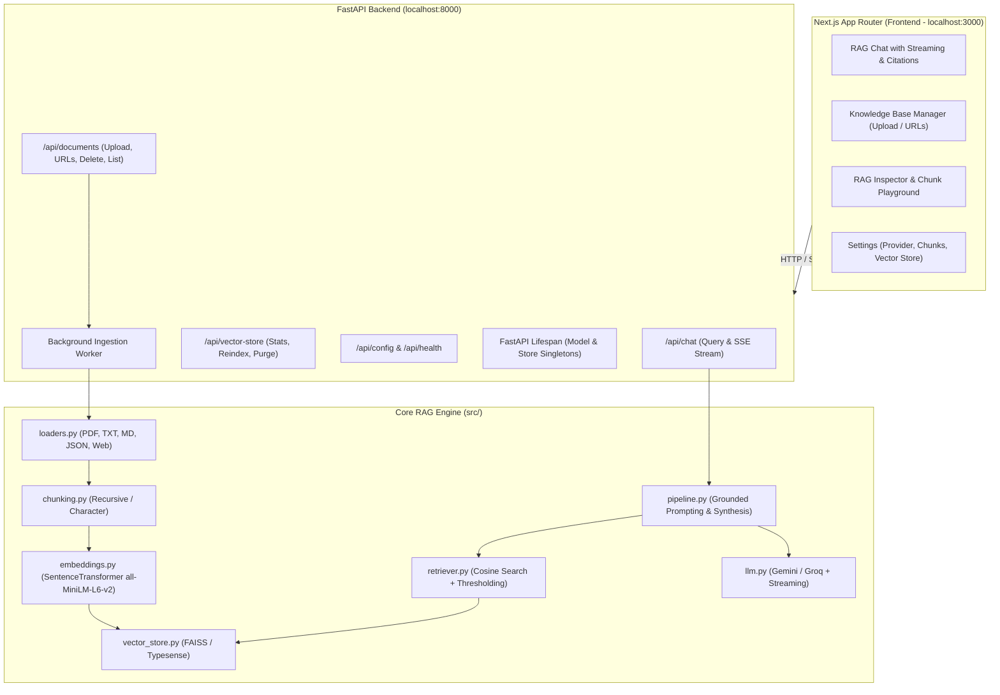

# RAG SaaS Application — Comprehensive Audit & Phased Development Plan

## 1. Executive Project Audit & Current State Analysis

Based on our thorough audit of the repository and the issues documented in [`issues.md`](file:///c:/Users/Asus/RAG/issues.md), here is the assessment of the existing codebase:

### 1.1 Core Strengths
- **Modular Pipeline**: The codebase in [`src/`](file:///c:/Users/Asus/RAG/src) is cleanly separated into dedicated components: [`loaders.py`](file:///c:/Users/Asus/RAG/src/loaders.py), [`chunking.py`](file:///c:/Users/Asus/RAG/src/chunking.py), [`embeddings.py`](file:///c:/Users/Asus/RAG/src/embeddings.py), [`vector_store.py`](file:///c:/Users/Asus/RAG/src/vector_store.py), [`retriever.py`](file:///c:/Users/Asus/RAG/src/retriever.py), and [`llm.py`](file:///c:/Users/Asus/RAG/src/llm.py).
- **Dual Vector Store Backends**: Supports both cloud-ready **Typesense** and local persistent **FAISS** with cosine similarity.
- **Multi-Model LLM Abstraction**: Supports Google Gemini and Groq (LLaMA 3.3).
- **Deterministic Document IDs**: Both vector stores use SHA-256 content hashes to prevent duplicate ingestion of identical chunks.

### 1.2 Identified Issues & Architectural Bottlenecks (from `issues.md` + Code Audit)
| Area | Issue Description | Impact on SaaS Architecture | Remediation in Plan |
| :--- | :--- | :--- | :--- |
| **Dependency & Runtime** | Dual dependency files (`pyproject.toml`, `requirements.txt`, managed via `uv`) + Python 3.13 requirement. | Confusing onboarding, potential version drift in deployments. | Standardize on `uv` & sync `pyproject.toml` with `requirements.txt`. |
| **Execution Model** | `main.py` is a synchronous one-off script with a hardcoded query. Rebuilds embeddings on every run. | Heavy startup overhead, no interactive or API-based query capabilities. | Decouple ingestion from querying; introduce persistent vector store lifecycle in FastAPI. |
| **Model Ingestion Lifecycle** | `SentenceTransformer` loads PyTorch weights into memory each time. | Heavy memory consumption and latency if reloaded per request. | Implement singleton model loading via FastAPI `lifespan` manager. |
| **LLM Provider API Call** | `src/llm.py` uses `client.interactions.create` for Gemini, which can be brittle across `google-genai` versions, and lacks token streaming. | Inability to provide real-time typing responses in UI. | Standardize Gemini API client calls and add server-sent event (SSE) streaming. |
| **Document State & Deletion** | No metadata tracking for files (file ID, date added, chunk counts) and no document pruning/deletion API. | Stale embeddings remain in index if files are modified or deleted. | Add Document Registry and document-level deletion/pruning in vector stores. |
| **Lack of SaaS / API Layer** | No HTTP server, no CORS, no request validation, no progress tracking for large uploads. | Cannot be consumed by web frontends. | Build FastAPI REST API with Pydantic validation & background tasks. |
| **No User Interface** | CLI/script only; no visualization of retrieved chunks, similarity scores, or document management. | Poor user experience. | Modern Next.js (App Router) interface with Dark/Light mode, Chat, Knowledge Base manager, and Playground. |

---

## 2. Target System Architecture

---

## 3. Phased Implementation Roadmap

### Phase 1: Core Engine Refactoring & Consolidation (COMPLETED)
**Goal**: Prepare the existing Python codebase to serve as an asynchronous, robust backend foundation.
- [x] **1.1 Dependency & Environment Standardization**:
  - Add `fastapi`, `uvicorn[standard]`, `python-multipart`, `sse-starlette` to dependencies.
  - Sync `pyproject.toml` and lockfile using `uv`.
- [x] **1.2 LLM Streaming & Modern Gemini Client Integration**:
  - Update [`src/llm.py`](file:///c:/Users/Asus/RAG/src/llm.py) to support both synchronous responses and asynchronous generator streaming (`stream_generate`).
  - Ensure compatibility with `google-genai` and `langchain-groq`.
- [x] **1.3 Document Registry & Store Management**:
  - Enhance [`src/vector_store.py`](file:///c:/Users/Asus/RAG/src/vector_store.py) to support:
    - Listing indexed documents and chunk statistics (`list_documents`, `get_stats`).
    - Deleting all chunks belonging to a specific `source_file` or document ID (`delete_document`).
    - Index clearing and re-indexing capability (`clear`).
- [x] **1.4 Dynamic Ingestion Loader**:
  - Support single-file dynamic ingestion in memory or temporary storage for file uploads (PDF, TXT, MD, JSON) via `load_single_file` and `load_single_url` without requiring manual placement in `data/text_files`.
- [x] **1.5 Pipeline Streaming Interface**:
  - Added `rag_stream` in [`src/pipeline.py`](file:///c:/Users/Asus/RAG/src/pipeline.py) returning metadata (sources, confidence, context) and real-time token generator for Server-Sent Events (SSE).

---

### Phase 2: FastAPI Backend Engine (COMPLETED)
**Goal**: Build a clean, scalable REST & Streaming API wrapping all RAG functionalities.
- [x] **2.1 Server Architecture & Lifespan**:
  - Created `api/` package with [`api/main.py`](file:///c:/Users/Asus/RAG/api/main.py) and [`api/services.py`](file:///c:/Users/Asus/RAG/api/services.py).
  - Implemented FastAPI `lifespan`: pre-warms `EmbeddingManager` and initializes `VectorStore` once at startup as singletons.
  - Configured CORS middleware for Next.js frontend (`http://localhost:3000`).
- [x] **2.2 Document Management API Endpoints**:
  - `POST /api/documents/upload`: Upload file(s) (`.pdf`, `.txt`, `.md`, `.json`) with optional chunking override parameters.
  - `POST /api/documents/url`: Ingest web pages dynamically from URL.
  - `GET /api/documents`: List all ingested documents, metadata, and chunk counts.
  - `DELETE /api/documents/{document_id}`: Remove a document and its chunks from vector storage.
  - `POST /api/documents/reindex`: Reindex all documents cleanly.
- [x] **2.3 Query & Streaming Chat Endpoints**:
  - `POST /api/chat/query`: Standard Q&A returning answer, sources, scores, confidence, and context.
  - `POST /api/chat/stream`: Server-Sent Events (SSE) streaming LLM tokens in real time with metadata citations sent immediately.
- [x] **2.4 Vector Store & Config Endpoints**:
  - `GET /api/config`: Current active provider, embedding model, vector store backend, and status.
  - `GET /api/vector-store/stats`: Total chunks, vector dimension, backend type, index health.
  - `DELETE /api/vector-store/clear`: Purges indexed chunks.
  - `GET /api/health`: Health check endpoint.
- [x] **2.5 Automated API Unit & Integration Tests**:
  - Unittest test suite [`tests/test_api.py`](file:///c:/Users/Asus/RAG/tests/test_api.py) covering all endpoints, returning 7/7 passing tests in 0.15s.

---

### Phase 3: Next.js (App Router) Frontend
**Goal**: Build a stunning, responsive, and intuitive web application showcasing all RAG utilities.
- [ ] **3.1 Next.js Project Setup**:
  - Initialize Next.js project with App Router, TypeScript, and modern styling.
  - Implement sleek dark-mode first design system (curated palette, glassmorphism, micro-interactions).
- [ ] **3.2 Utility 1: Interactive RAG Chatbot**:
  - Real-time streaming response UI.
  - Confidence score badge (High / Medium / Low).
  - Expandable Source Citations card: displays similarity score, source document name, page number, and chunk text snippet.
  - Reset session / query history.
- [ ] **3.3 Utility 2: Knowledge Base Document Center**:
  - Drag-and-drop file upload zone for PDF, Markdown, Text, and JSON.
  - Web URL ingestion input with immediate status indicators.
  - Document table displaying file name, type, chunks indexed, ingestion timestamp, and one-click deletion.
  - Background ingestion progress indicator.
- [ ] **3.4 Utility 3: RAG Inspector & Playground**:
  - Test retrieval without LLM synthesis (pure semantic search playground).
  - Interactive sliders: `top_k` (1–10) and `min_score` threshold (0.0–1.0).
  - Chunk preview visualizer showing how text is split based on chunk size and overlap.
- [ ] **3.5 Utility 4: System Control & Provider Settings**:
  - Switch between FAISS (Local) and Typesense (Cloud).
  - Switch between Gemini and Groq models.
  - Test API key connectivity and view vector store diagnostics.

---

### Phase 4: SaaS Hardening & Production Polish
**Goal**: End-to-end verification, performance tuning, and developer experience polish.
- [ ] **4.1 Multi-Session & Conversation Memory**:
  - Optional conversation context handling across multiple chat turns.
- [ ] **4.2 Robust Error Handling & Empty States**:
  - User-friendly messages when vector store is empty, API keys are missing, or network fails.
- [ ] **4.3 Verification & End-to-End Testing**:
  - Test document upload -> chunking -> vector indexing -> retrieval -> LLM answer flow end to end.
- [ ] **4.4 Run Scripts & Documentation**:
  - Single-command dev startup (e.g. `npm run dev` + `uvicorn`).
  - Updated README with instructions for both backend and frontend.

---

## 4. Phase Execution Summary
| Phase | Focus | Key Deliverables | Estimated Steps |
| :--- | :--- | :--- | :--- |
| **Phase 1** | Python Engine Modernization | Streaming LLM, document deletion in vector store, uv dependency alignment | 3 |
| **Phase 2** | FastAPI Backend | REST endpoints, SSE streaming, lifespan singleton, Pydantic schemas | 4 |
| **Phase 3** | Next.js Frontend | Modern UI, Chat with citations, Knowledge Base manager, Inspector playground | 4 |
| **Phase 4** | Integration & Polish | E2E testing, multi-turn chat, configuration diagnostics, documentation | 2 |
